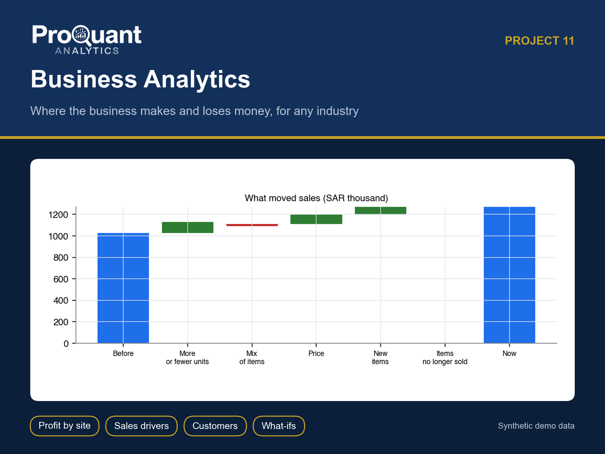
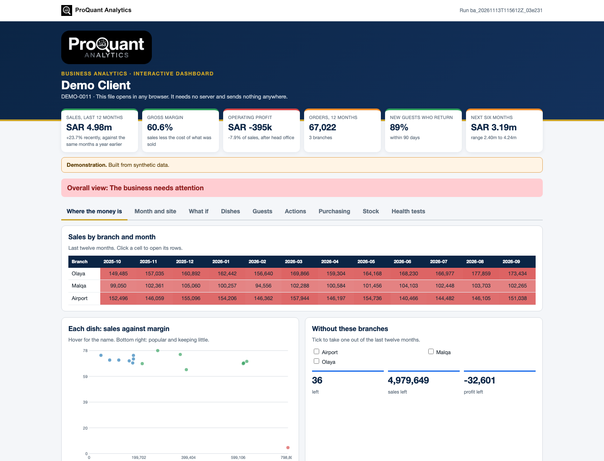
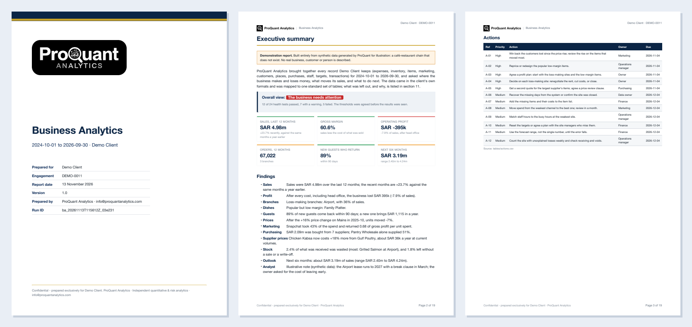
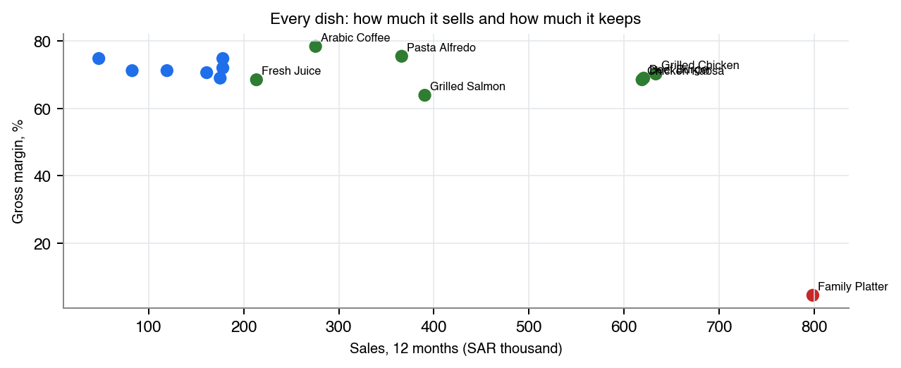
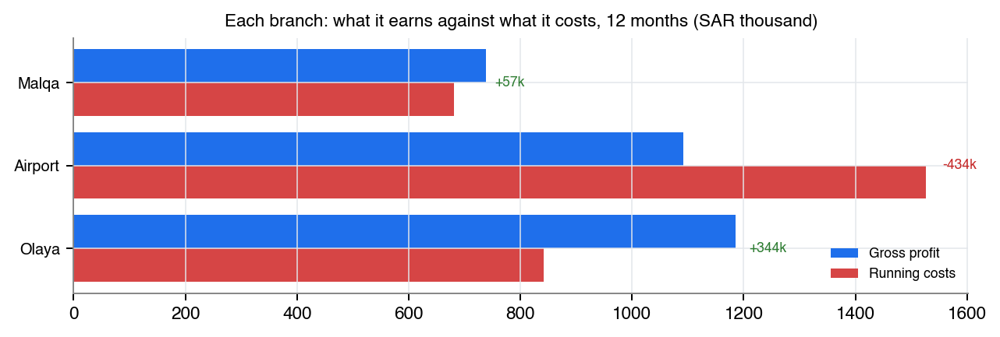
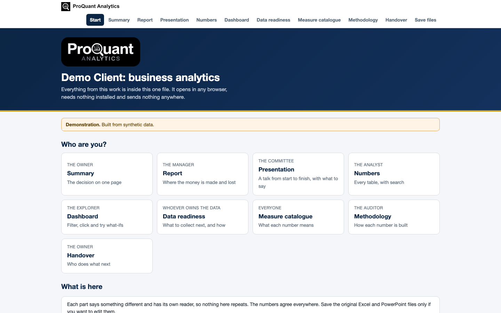

# Business Analytics

**Where the business makes money, where it loses it, and what to do next. For any industry.**

  

> **Showcase repository.** It shows the method and the actual files a client receives, built on **synthetic demo data** (a fictional *Demo Client*). The numbers below are illustrative, not client results. The production code is proprietary and is not published here.

## Contents

- [Business problem](#business-problem)
- [Approach](#approach)
- [Results (demo)](#results-demo)
- [Deliverables](#deliverables)
- [Gallery](#gallery)
- [Tech stack](#tech-stack)
- [How to view it](#how-to-view-it)
- [How an engagement works](#how-an-engagement-works)

## Business problem

Sales are visible every day; profit is not. Nobody knows which site pays for the others, which best-seller earns nothing, whether the last price rise cost loyal customers, or which marketing channel brings people back.

**Typical clients:** Retail, hospitality, healthcare clinics, logistics and ports, and services firms with several sites.

## Approach

- Any source (exports, databases, APIs, Google Sheets) mapped to standard tables, with a readiness assessment
- Sales trend and forecast; what moved sales, split exactly into volume, mix, price and new or dropped items
- Profit by site with every cost booked; sales per seat, per square metre and per staff hour
- Items on sales and margin; customers (new, returning, lost, first-year value); price-change effects
- Marketing payback by channel; targets; what-ifs for a new site and a price change
- Purchasing and stock: supplier dependence, price rises not passed on, late deliveries, waste and stock that left without a sale
- 24 health tests with one action and an owner for each test that does not pass

## Results (demo)

**Overall opinion on the demo data:** Overall view: The business needs attention

| Measure | Value | Context |
|---|---:|---|
| Sales, last 12 months | **SAR 4.98m** | +23.7% recently, against the same months a year earlier |
| Gross margin | **60.6%** | sales less the cost of what was sold |
| Operating profit | **SAR -395k** | -7.9% of sales, after head office |
| Orders, 12 months | **67,022** | 3 branches |
| New guests who return | **89%** | within 90 days |
| Next six months | **SAR 3.19m** | range 2.40m to 4.24m |

<em>The interactive dashboard (one HTML file: Where the money is, Month and site, What if, Dishes, Guests, Actions, Purchasing, Stock, Health tests). <a href="https://abduwars.github.io/proquant-11-business-analytics/sample-delivery/10_DemoClient_BusinessAnalytics_Dashboard_v1.0_20261113.html">Open it live</a>.</em>

## Deliverables

Everything opens from **one file**, *Start here* (no. 1), in any browser: pick your role, read each document, watch the presentation, search the tables and use the dashboard. Each document has one reader and one job, and the numbers agree across all of them. PowerPoint and Excel files open in the browser through Microsoft's free online viewer; *download* gives the original file.

| # | File | Format | What it is |
|---|---|---|---|
| 1 | [Start here](https://abduwars.github.io/proquant-11-business-analytics/sample-delivery/00_START_HERE_DemoClient.html) | HTML (opens in any browser) | **One file that holds it all**: every document, the presentation, the tables and the dashboard |
| 2 | [Report](sample-delivery/01_DemoClient_BusinessAnalytics_Report_v1.0_20261113.pdf) | PDF | *The manager*: Where the money is made and lost, with the evidence (~16 pages) |
| 3 | [Summary](sample-delivery/02_DemoClient_BusinessAnalytics_Summary_v1.0_20261113.pdf) | PDF | *The owner*: One page: the decision, with no charts |
| 4 | [Presentation](https://view.officeapps.live.com/op/view.aspx?src=https%3A%2F%2Fabduwars.github.io%2Fproquant-11-business-analytics%2Fsample-delivery%2F03_DemoClient_BusinessAnalytics_Presentation_v1.0_20261113.pptx) | PowerPoint · [download](https://raw.githubusercontent.com/AbduWars/proquant-11-business-analytics/main/sample-delivery/03_DemoClient_BusinessAnalytics_Presentation_v1.0_20261113.pptx) | *The management team*: **A full talk**: about 15 slides with editable charts and speaker notes, ready to present |
| 5 | [Results Workbook](https://view.officeapps.live.com/op/view.aspx?src=https%3A%2F%2Fabduwars.github.io%2Fproquant-11-business-analytics%2Fsample-delivery%2F04_DemoClient_BusinessAnalytics_ResultsWorkbook_v1.0_20261113.xlsx) | Excel · [download](https://raw.githubusercontent.com/AbduWars/proquant-11-business-analytics/main/sample-delivery/04_DemoClient_BusinessAnalytics_ResultsWorkbook_v1.0_20261113.xlsx) | *The analyst*: **The working file**: a Control panel with live formulas by site, and every table. Opens on a **Read me** sheet with a linked index |
| 6 | [Methodology](sample-delivery/05_DemoClient_BusinessAnalytics_Methodology_v1.0_20261113.pdf) | PDF | *The auditor*: How each number is built. No results |
| 7 | [Handover Note](sample-delivery/06_DemoClient_BusinessAnalytics_HandoverNote_v1.0_20261113.pdf) | PDF | *The owner*: Who does what next, which file is for whom |
| 8 | [Action Tracker](https://view.officeapps.live.com/op/view.aspx?src=https%3A%2F%2Fabduwars.github.io%2Fproquant-11-business-analytics%2Fsample-delivery%2F07_DemoClient_BusinessAnalytics_ActionTracker_v1.0_20261113.xlsx) | Excel · [download](https://raw.githubusercontent.com/AbduWars/proquant-11-business-analytics/main/sample-delivery/07_DemoClient_BusinessAnalytics_ActionTracker_v1.0_20261113.xlsx) | *Each action's owner*: Every action with an owner, a date and a status drop-down; the dashboard reads it back |
| 9 | [Data Readiness](sample-delivery/08_DemoClient_BusinessAnalytics_DataReadiness_v1.0_20261113.pdf) | PDF | *Whoever owns the data*: What the data can answer, what is missing, and the better way to collect each source |
| 10 | [Measure Catalogue](sample-delivery/09_DemoClient_BusinessAnalytics_MeasureCatalogue_v1.0_20261113.pdf) | PDF | *Everyone*: One agreed definition for every number, and the words used for this business |
| 11 | [Dashboard](https://abduwars.github.io/proquant-11-business-analytics/sample-delivery/10_DemoClient_BusinessAnalytics_Dashboard_v1.0_20261113.html) | HTML (opens in any browser) | *Whoever explores*: Sales by site and month (click to drill), items on sales and margin, **what-ifs** for a new site and a price change, and **Load the updated tracker** |

Also delivered: data-quality reports and long-format CSV / Parquet exports for Power BI or Looker Studio.

<em>The first pages of the PDF report.</em>

## Gallery

<table><tr>
<td width="50%"></td>
<td width="50%"></td>
</tr></table>

<em>The start page: one file, one click, nothing to install.</em>

## Tech stack

Python · pandas · NumPy · matplotlib · Jinja2 + WeasyPrint (PDF) · openpyxl (Excel) · python-pptx (PowerPoint) · pydantic · pytest

Every run is reproducible and audited: data fingerprints, configuration and code version are recorded, data-quality checks run before any calculation, and an automated test suite checks every deliverable (including opening the decks and workbooks in Microsoft Office).

## How to view it

1. **In the browser (nothing to install):** open the [live start page](https://abduwars.github.io/proquant-11-business-analytics/sample-delivery/00_START_HERE_DemoClient.html) or the [dashboard](https://abduwars.github.io/proquant-11-business-analytics/sample-delivery/10_DemoClient_BusinessAnalytics_Dashboard_v1.0_20261113.html).
2. **Download:** click any PDF, Excel or PowerPoint file in the table above, or clone the repository: `git clone https://github.com/AbduWars/proquant-11-business-analytics.git`.
3. **On your own data:** this is delivered as a fixed-scope engagement. Write to [info@proquantanalytics.com](mailto:info@proquantanalytics.com).

## How an engagement works

| Step | What happens |
|---|---|
| 1. Discovery call | Your question, your data and the decision the work must support |
| 2. Scope and NDA | Fixed scope, timeline and thresholds agreed **before** any result is seen |
| 3. Data request | A precise list of files or read-only access; personal data pseudonymised |
| 4. Build and interim update | First results, open questions and data issues, early |
| 5. Delivery | The full package above, on your data, with a walk-through |
| 6. Handover | Methodology, runbook where relevant, and optional monthly refresh |

---

<b>ProQuant Analytics</b> · Quant & risk analytics, business analytics, data engineering and AI automation Rotterdam, NL · remote-first <a href="https://www.proquant-analytics.com">www.proquant-analytics.com</a> · <a href="mailto:info@proquantanalytics.com">info@proquantanalytics.com</a> · <a href="https://github.com/AbduWars">All 13 projects</a>

© 2026 ProQuant Analytics. Sample outputs on synthetic data, shown for demonstration. All rights reserved.

